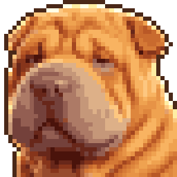

# Pupp Companion

A wrinkly Shar-Pei puppy that lives on your Windows desktop, drawn in chunky pixel art.



## What the puppy does

- **Wanders and naps** along the bottom of your screen, and dozes off when you step away.
- **Loves pets** – click or stroke it for hearts. Drag it to pick it up by the scruff and drop it somewhere else.
- **Follows your cursor** when it gets too far away.
- **Gentle reminders** – a speech bubble nudges you to drink water, stretch or rest your eyes.

Right-click the puppy (or its tray icon) for settings: follow on/off, reminder
interval, size, start with Windows, quit.

## Get it

**Download:** every push to `main` builds the Windows app. Open the repo's
*Actions* tab → latest *Build Windows app* run → download the
`PuppCompanion-windows` artifact. It contains an installer and a portable `.exe`.

**Run from source** (needs [Node.js](https://nodejs.org)):

```bash
npm install
npm start
```

**Build the .exe yourself** (on Windows):

```bash
npm run dist
```

## Changing the art

Green-screen renders live in `art/raw`. After replacing one, regenerate the
pixel-art sprites in `assets/`:

```bash
pip install pillow numpy scipy
python tools/process_sprites.py
```
